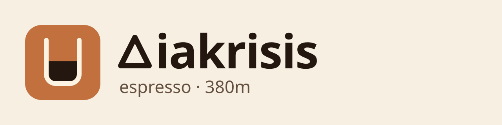

<picture>
  <source media="(prefers-color-scheme: dark)" srcset="logo/banner-espresso-dark.svg">
  
</picture>

# Diakrisis

Small open models that make typed decisions about text. Diakrisis is Greek for "discernment, telling things apart". The models are named after espresso drinks.

| Model | Size | Status |
|---|---|---|
| [espresso-380m](espresso-380m/README.md) | 380M parameters | v1.0 |
| ristretto | smaller | planned |
| doppio | larger | planned |
| lungo | long context | planned |

## What a typed decision is

You give the model a text and one or more typed questions. It returns a probability for each answer.

- `noul`: yes or no.
- `choice`: one option from a list, which can include "none of these".
- `score`: one level on an ordered scale.

## espresso-380m in short

- A 380M encoder distilled from Cloudflare Clef-flash (9.4B).
- Overall accuracy on 19 audit suites: 0.795, against 0.793 for the teacher. Hosted Jev 1.14 scores 0.821.
- It passed its one-shot confirmation, and 7 of 9 retention checks against its base model.
- On many-option choices it returns REVIEW when it is unsure, so a human can decide.
- English only. Apache-2.0.

The [model card](espresso-380m/README.md) has the full results, the limits and the training data. The [comparison table](espresso-380m/COMPARISON.md) has every suite.

Model page: https://huggingface.co/diakrisis/espresso-380m

## What is in this repo

| Path | Contents |
|---|---|
| `espresso-380m/` | model card, frozen decision rule, comparison table |
| `logo/` | family marks and banners |
| `LICENSE`, `NOTICE` | Apache-2.0 and attributions |

TODO: inference wrapper and quick start.

## Licence

Apache-2.0. See [LICENSE](LICENSE) and [NOTICE](NOTICE).

Made by Caffeinated Software LLC.
