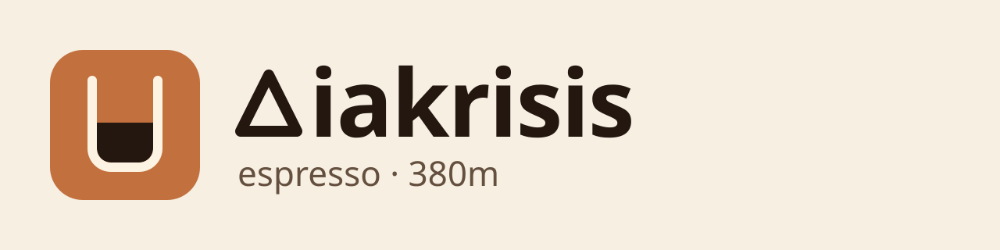

# diakrisis/espresso-380m

A 380M-parameter encoder that answers typed questions about a text and returns a probability for each answer. It runs on a CPU with ONNX Runtime and needs no PyTorch. It is distilled from Cloudflare Clef-flash (9.4B) and scores about the same as that teacher overall on 19 audit suites (0.795 vs 0.793). Two hosted models score higher; see "Evaluation status".

Diakrisis is Greek for "discernment, telling things apart". Espresso is the first model in the family.

## What it does

You give it a text (the "state") and one or more typed questions. It returns a probability for each possible answer, and a decision.

| Question type | What it answers |
|---|---|
| `noul` | yes or no |
| `choice` | one option from a list, which can include `none_of_these` |
| `score` | one level on an ordered scale |

The request format is the same one used by Clef and Jev.

What is inside:

- Base encoder: `vllm-sr/vela3-fast` (itself based on `dmis-lab/UltraBERT-380M`), fine-tuned with a LoRA adapter (rank 16) plus small decision heads.
- Two ONNX builds for CPU (below).
- A frozen decision rule, `decision_rule.json`.
- A small wrapper, `espresso.py`.

## Quick start

```bash
pip install onnxruntime tokenizers safetensors numpy
```

```python
from espresso import Espresso

m = Espresso("espresso-380m")  # path to the downloaded model folder

m.decide("I was charged twice this month.", {
    "billing": {"type": "noul", "instructions": "Is this about billing?"},
    "team": {"type": "choice", "instructions": "Which team handles it?",
             "criteria": {"billing": "Payments and refunds", "tech": "Bugs and outages"}},
    "urgency": {"type": "score", "instructions": "How urgent is it?",
                "criteria": ["low", "medium", "high"]},
})
```

Each answer has the model's probabilities and a `decision`. The wrapper applies the decision rule for you, including REVIEW.

There are two builds:

| Build | How to load | Size | Agreement with the evaluated model |
|---|---|---|---|
| fp32 (default, exact) | `Espresso(path)` | 1.5 GB | 414 of 414 decisions |
| w8 (8-bit block-wise weights) | `Espresso(path, precision="w8")` | 573 MB | 412 of 414 decisions |

## Decision rule

The rule is frozen and ships with the model. It has two parts.

**Many-option choices.** On `choice` questions with at least 50 options that include `none_of_these`:

1. `none_of_these` gets a small boost (0.25).
2. If the top answer's probability is below 0.88, the decision is **REVIEW** instead of an answer.

**Pass/fail choices.** On a `choice` over exactly `PASS` and `FAIL`, `PASS` gets a small penalty (−0.15).

The aim is to send uncertain many-option cases to a human instead of answering wrong without warning. The targets were: at most 25% sent to review, under 5% silent misses, under 5% silent wrong answers.

## Evaluation results

**Confirmation** (run once, on fresh items never used for tuning): passed.

| Check | Result |
|---|---|
| Gates on the main confirmation set | 17 of 17 passed |
| Many-option set, sent to review | 23.2% (209/900) |
| Many-option set, silent misses | 2.3% (7/300) |
| Many-option set, silent wrong answers | 2.2% (13/600) |
| Long documents, change against the base model | 0.0008 absolute, agreement 0.963 |

**Gains over the base model** (vela3-fast) on the 19 audit suites:

| Measure | Base | Espresso |
|---|---|---|
| Overall accuracy | 0.719 | 0.795 |
| Prompt-injection AUROC | 0.843 | 0.942 |

**Release builds against the evaluated model.** All scores on this card were measured on a GPU. The shipped CPU builds were checked against those GPU predictions on 190 items (414 decisions):

| Check | Result |
|---|---|
| fp32 build, decisions that match | 414 of 414 |
| w8 build, decisions that match | 412 of 414 |
| Tokenizer mismatches | 0 in 8,245 texts |

**CPU speed (indicative only).** Measured on one desktop CPU with 20 threads; this is not a benchmark.

- Bare encoder: about 76 ms for 64 tokens, about 240 ms for 256 tokens.
- Windowed attention on the 16 local layers gives identical results and is up to 39% faster than dense attention at 8k tokens.

## Evaluation status

- **The audit did not fully pass.** It has 9 retention checks against the base model. Espresso passed 7. The two misses are narrow:
  - Long-input retention: the lower 95% bound was −0.0200; the limit was above −0.02.
  - Policy originals: −1.1 points; the limit was −1.0 point.
- v1.0 is released anyway, with this result stated here.
- **The 19 audit suites are not fresh data.** They are held-out test splits, but they were used for evaluation in earlier development rounds. Only the confirmation set above was untouched.
- **Two hosted models score higher overall.** Gemini Decision 1 (Google) scores 0.828 and Jev 1.14 (TypeSafe) scores 0.821, against Espresso's 0.795.
- In the comparison below, a REVIEW from Espresso counts as a wrong answer.

## Comparison with other models

Overall accuracy on the 19 audit suites: same items, same scorer. Hosted runs were made on 2026-11-17.

| Model | Size | Overall | Overall without synth_options_xl |
|---|---|---|---|
| Gemini Decision 1 (Google, hosted API) | not disclosed | 0.828 | 0.832 |
| Jev 1.14 (TypeSafe, hosted API) | not disclosed | 0.821 | 0.824 |
| **espresso-380m** | **380M** | **0.795** | **0.794** |
| Clef-flash (teacher) | 9.4B | 0.793 | 0.794 |
| gliclass-v4-edge | | 0.745 | 0.749 |
| vela3-fast (base) | 380M | 0.719 | 0.720 |
| open-jev-deberta | | 0.600 | 0.603 |
| laya | | 0.519 | 0.522 |

Notes:

- Both hosted APIs reject choice questions with more than 255 options. Those items count as wrong in the "Overall" column. The last column leaves that suite (synth_options_xl) out for every model. Espresso scores 0.957 on it.
- Gemini Decision 1 refused 20 items with a safety block. They count as wrong.
- Jev, jevbench and tasksource_jev all use TypeSafe's request format, so Jev may have a home advantage on those two suites.

Where Espresso leads both hosted models:

| Suite | Espresso | Gemini Decision 1 | Jev 1.14 |
|---|---|---|---|
| Prompt-injection detection (pi_detect) | 0.848 | 0.730 | 0.702 |
| Customer-service decisions (abcd_test) | 0.924 | 0.898 | 0.902 |
| Customer service with injections (abcd_injection) | 0.891 | 0.884 | 0.855 |
| Many options (many_options) | 0.934 | 0.909 | 0.901 |
| Long inputs (long_inputs) | 0.744 | 0.724 | 0.740 |

Where Espresso trails most:

| Suite | Espresso | Gemini Decision 1 | Jev 1.14 | Clef-flash (teacher) |
|---|---|---|---|---|
| Business policy (synth_policy_biz) | 0.560 | 0.933 | 0.900 | 0.690 |
| Multi-step dependent questions (synth_multi_dependent) | 0.424 | 0.771 | 0.728 | 0.591 |
| Policy (policy) | 0.613 | 0.858 | 0.872 | 0.638 |
| typed_synth | 0.738 | 0.886 | 0.903 | 0.865 |

The full per-suite table is in `COMPARISON.md`.

## Training data and licences

Training targets are the output distributions of the Clef-flash teacher (Apache-2.0).

| Source | Licence |
|---|---|
| Generated by this project (options, steer, synth, typed-synth parts) | Caffeinated Software LLC |
| ABCD (`asappresearch/abcd`) | MIT |
| LLMail-Inject (`microsoft/llmail-inject-challenge`) | MIT |
| PromptShield (`hendzh/PromptShield`) | Apache-2.0 |
| DynaBench | MIT |
| typed-decisions-synth | MIT |
| tasksource typed decisions | commercial-licensed rows only |
| LEDGAR and SCOTUS (LexGLUE) | CC-BY-4.0 |
| CLINC150 | CC-BY-3.0 |

Not in the training data:

- No outputs from proprietary models. Jev-labelled data was quarantined.
- No SQuAD (share-alike, dropped).
- No tasksource rows without a commercial licence.

Hardware: trained on AWS g6e instances (one NVIDIA L40S). Total project compute was about $200.

## Intended use and limits

Intended use: typed decisions over text on a CPU, such as routing, policy checks, option selection and prompt-injection screening.

Limits:

- English only.
- Not for medical, legal or safety-critical decisions without human review.
- A REVIEW output needs a human. Do not treat it as an answer.
- Inputs above about 23k tokens are untested.
- Weak on multi-step dependent questions (0.424) and on policy questions (0.613).
- The wrapper runs on CPU only.

## Attribution / NOTICE

```
diakrisis/espresso-380m - Copyright 2026 Caffeinated Software LLC. Licensed under the Apache License, Version 2.0.

Fine-tuned from vllm-sr/vela3-fast (Apache-2.0), itself based on dmis-lab/UltraBERT-380M (Apache-2.0).
Distilled from Cloudflare Clef-flash (Apache-2.0).
Training data includes: LEDGAR and SCOTUS from LexGLUE (CC-BY-4.0); CLINC150 (CC-BY-3.0);
DynaBench (MIT); typed-decisions-synth (MIT);
tasksource typed decisions (commercial-licensed rows only);
ABCD (MIT); LLMail-Inject (MIT); PromptShield (Apache-2.0).
```

## Citation

```bibtex
@misc{diakrisis_espresso_380m_2026,
  title  = {diakrisis/espresso-380m: a 380M typed-decision model},
  author = {{Caffeinated Software LLC}},
  year   = {2026},
  url    = {https://huggingface.co/diakrisis/espresso-380m}
}
```
